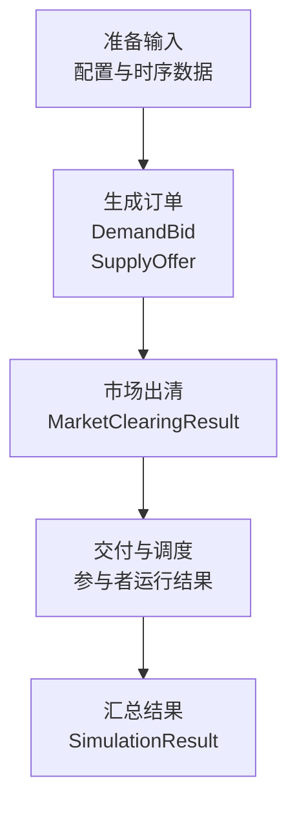
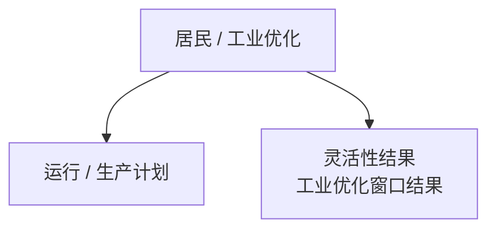
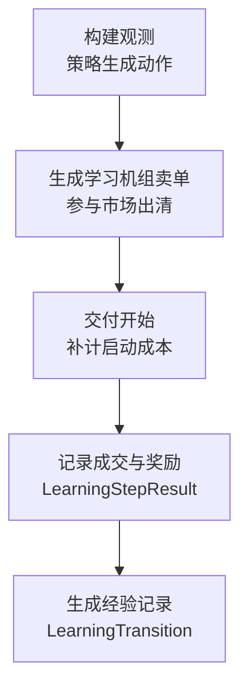

# models：电力市场仿真的数据模型

本目录定义仿真过程中共享的数据结构：市场配置、参与者参数、买卖订单、出清结果，以及一次仿真的完整结果。阅读时可以沿着“参与者 → 订单 → 出清 → 调度 → 仿真汇总”的顺序理解。

## 1. 目录职责与使用方式

这些模型负责保存数据、提供派生计算，并在部分对象创建时检查数据是否符合约定。例如，发电机组可以计算边际成本，储能结果可以计算 SOC，市场出清结果可以核对成交电量与结算金额。

相关业务流程位于本目录之外：

| 模块 | 与 models 的关系 |
| --- | --- |
| [config/loader.py](../config/loader.py)、[inputs/csv_loader.py](../inputs/csv_loader.py) | 读取并校验配置与 CSV，创建配置和参与者对象 |
| [bidding.py](../bidding.py) | 根据参与者参数、时段数据与策略生成订单 |
| [clearing_algorithm](../clearing_algorithm/) | 接收买卖订单，计算成交电量与结算价格，返回出清结果 |
| [household.py](../household.py)、[industry.py](../industry.py) | 计算居民运行计划、工业生产计划及灵活性等结果 |
| [simulators](../simulators/)、[simulation.py](../simulation.py) | 组织开市、出清、运行状态更新和结果汇总 |
| [learning.py](../learning.py)、[training.py](../training.py) | 生成学习动作、经验记录并执行训练 |
| [reporting.py](../reporting.py)、[plotting](../plotting/) | 将结果导出为报告或图表 |

本目录中的类均采用 `@dataclass(frozen=True)`，创建后不能直接重新赋值字段。需要生成更新后的对象时，可使用 `dataclasses.replace()`。类型注解表达字段约定，但不会自动完成类型或范围校验；具体校验位置见第 7 节。

[__init__.py](__init__.py) 统一导出了各领域模型，因此调用方可以直接从 `electricity_market_sim.models` 导入，示例见第 8 节。

## 2. 文件与主要对象速查

| 文件 | 主要对象 | 用途 |
| --- | --- | --- |
| [market.py](market.py) | `MarketSettings`、`MarketOpening` | 市场配置与一次开市的产品安排 |
| [plants.py](plants.py) | `PowerPlant` | 发电机组参数及边际成本计算 |
| [demand.py](demand.py) | `DemandUnit`、`ExchangeUnit`、`ExchangeSchedule` | 普通需求参与者与计划进出口 |
| [storage.py](storage.py) | `StorageUnit`、`StorageClearingContext`、`StorageDispatchResult` | 储能参数、联合出清上下文与运行结果 |
| [household.py](household.py) | `HouseholdUnit`、`HouseholdPlan`、`HouseholdDispatchResult`、`HouseholdFlexibilityResult` | 居民建筑参数、计划、实际运行与灵活性范围 |
| [industry.py](industry.py) | `IndustrialDevice`、`IndustrialUnit`、`IndustrialPlan`、`IndustrialDispatchResult`、`IndustrialFlexibilityResult`、`IndustrialOptimizationWindowResult` | 工业钢铁厂设备、生产计划、运行及滚动优化结果 |
| [learning.py](learning.py) | `LearningConfig`、`LearningStepResult`、`LearningTransition` | 学习配置、逐时段动作与奖励、经验回放记录 |
| [orders.py](orders.py) | `DemandBid`、`SupplyOffer` | 出清前的买单与卖单 |
| [clearing.py](clearing.py) | `ClearedDemandBid`、`ClearedSupplyOffer`、`Trade`、`MarketClearingResult`、`sum_cleared_demand()` | 订单成交结果、逐笔成交、单产品汇总与需求筛选求和 |
| [results.py](results.py) | `SimulationResult` | 一次仿真运行的完整内存结果 |
| [__init__.py](__init__.py) | 统一导出接口 | 汇集以上模型，供其他模块导入 |

## 3. 数据流与模型关系

### 3.1 业务主流程

先看一次仿真的主要处理顺序。输入包括市场配置、参与者参数和时序数据；每个框表示一个阶段，箭头表示先后顺序。各阶段的其他依赖在下方说明。



| 阶段 | 关键输入与作用 |
| --- | --- |
| 生成订单 | 结合交付产品、参与者参数、时序数据及报价策略；部分策略还使用预测、运行状态或历史成交安排 |
| 市场出清 | 出清算法处理买卖订单；储能联合复杂出清还使用 `StorageClearingContext` 约束储能量变化 |
| 交付与调度 | 结合成交量、参与者参数、适用的原计划及运行状态，计算实际运行结果 |
| 汇总结果 | 将市场结果、参与者调度结果，以及已启用的灵活性、工业窗口和学习记录一并保存 |

订单生成、出清和调度会随开市及交付安排重复进行，更新后的状态用于后续报价和优化。共用 EOM 事件引擎在交付开始时补计机组启动成本，在交付结束时更新机组和储能状态；居民场景按开市产品进行出清和运行计算。

### 3.2 居民与工业的计划优化

这条可选分支在生成订单之前执行，使用参与者参数、预测数据及当前运行状态。



运行和生产计划分别对应 `HouseholdPlan`、`IndustrialPlan`，用于生成买单，并与成交量一起参与后续调度计算。灵活性及工业窗口结果在该优化阶段计算，最后作为独立结果汇总。

### 3.3 学习场景分支

第五版学习场景使用学习配置、机组参数、预测和历史市场结果构建观测。图中展示从动作到经验记录的主要处理顺序。



当前观测和实际执行动作会被保留。奖励根据动作、成交结果和机组参数等计算；经验记录再结合已保存的观测、动作、奖励与下一状态生成。普通的 `LearningTransition` 需等待下一时段观测；最后一条在学习结束时使用终止状态，并设置 `done=True`。学习步结果与经验记录最终汇入 `SimulationResult`。

### 3.4 对象包含与引用关系

上面的图表示处理顺序，下表说明结果对象实际保存什么。

| 对象 | 保存或引用的内容 |
| --- | --- |
| `SimulationResult` | 市场配置、各产品市场结果，以及相应参与者、灵活性、工业窗口和学习记录 |
| `MarketClearingResult` | 单个交付产品的买卖订单出清结果及可选成交明细；一次开市可以产生多个产品结果 |
| `ClearedSupplyOffer` | `offer` 保留原始 `SupplyOffer` |
| `ClearedDemandBid` | `bid` 保留原始 `DemandBid` |
| `Trade` | 用订单标识引用买卖双方，不直接保存订单对象；同一订单可以对应多笔成交 |

当前 `pay_as_clear` 和 `pay_as_bid` 会记录实际发生的逐笔成交；`complex_clearing` 当前不生成 `Trade`，其 `trades` 为空元组。`HouseholdPlan`、`IndustrialPlan` 不直接作为字段保存在 `SimulationResult` 中，部分计划信息由调度结果保留。

## 4. 关键概念与字段约定

### 4.1 单位

| 字段形式 | 含义 | 例子 |
| --- | --- | --- |
| `*_mw` | 电功率，单位 MW | `offered_power_mw` |
| `*_mwh` | 能量，单位 MWh，可表示电量、储能量或氢气能量 | `accepted_energy_mwh`、`capacity_mwh`、`hydrogen_output_mwh` |
| `*_eur_per_mwh` | 单位电量价格或成本，单位 EUR/MWh | `bid_price_eur_per_mwh` |
| `*_eur` | 金额，单位 EUR | `profit_eur` |
| `*_mw_th`、`*_mwh_th` | 热功率、热量 | `heat_demand_mw_th`、`unmet_heat_mwh_th` |
| `*_t` | 质量，单位吨 | `planned_steel_output_t` |
| `*_soc`、`soc_before`、`soc_after` | 储能量占容量的比例，通常在 0～1 内 | `initial_soc=0.5` 表示 50% |

电量与平均功率的关系是：`电量 MWh = 功率 MW × 时长 h`。例如，10 MW 持续 15 分钟对应 2.5 MWh。`accepted_power_mw`、`cleared_power_mw` 会将成交电量除以交付时长。

### 4.2 开市与交付

- `opening_time`：本次市场开市的时间点。
- `delivery_start`、`delivery_end`：某个产品对应的交付时段。
- `first_delivery`：从开市到第一个产品交付开始的时间偏移，类型为 `timedelta`。
- `MarketOpening.products`：由 `(delivery_start, delivery_end)` 组成的元组，表示本次开市提供的全部交付产品。

例如，09:00 开市，`first_delivery=1h`、`product_duration=1h`、`product_count=2`，对应的两个产品为 10:00～11:00 和 11:00～12:00。

### 4.3 参与者与订单标识

| 字段或属性 | 含义 |
| --- | --- |
| 参与者的 `name` / 订单的 `unit_name` | 标识物理机组、建筑或其他参与者；一个参与者可以提交多条订单 |
| `DemandBid.identifier` | 使用 `bid_id`，未提供或为空时使用 `unit_name` |
| `SupplyOffer.identifier` | 使用 `offer_id`，未提供或为空时使用 `unit_name`；标识单个产品上的一条卖单 |
| `SupplyOffer.complex_identifier` | 使用 `bid_id`，未提供或为空时使用 `identifier`；可用于关联跨产品的同一复杂订单 |
| `Trade.buyer_bid_id` / `seller_offer_id` | 分别引用买单和卖单的 `identifier` |

同一产品内提交多条订单时，应为每条订单分配不同标识。复杂卖单中，多条产品分段可以共享 `bid_id`，同时使用不同的 `offer_id`。

## 5. 各领域模型说明

### 5.1 市场配置：market.py

`MarketSettings` 集中保存能量市场（EOM）的设置：

| 字段组 | 用途 |
| --- | --- |
| `start`、`end`、`time_step` | 仿真起止时间与时间步长 |
| `opening_frequency`、`opening_duration` | 开市频率与配置中的开市持续时间；当前事件调度尚未使用 `opening_duration` |
| `product_duration`、`product_count`、`first_delivery` | 每次开市提供的产品时长、数量及首个交付偏移 |
| `maximum_bid_price`、`minimum_bid_price` | 市场报价上下限 |
| `market_mechanism` | 出清机制：`pay_as_clear`、`complex_clearing` 或 `pay_as_bid` |
| `market_id`、`exchange_units_file`、`industrial_dsm_units_file` | 市场标识与可选参与者输入文件 |
| `additional_fields` | 订单附加元数据字段名集合 |
| `learning_config`、`seed` | 可选学习配置与随机种子 |

`MarketOpening` 仅保存一次开市的时间及其产品集合。实际开市安排由仿真模块生成。

### 5.2 发电、普通需求与交换：plants.py / demand.py

- `PowerPlant`：保存机组技术类型、报价策略、燃料、排放因子、功率上下限、效率及成本参数。`start_cost_eur` 是整台机组的启动成本；`min_operating_time_hours` 是最小运行时间。`min_down_time_hours` 当前用于兼容加载和校验，最小停机时间约束尚未实际执行。
- `DemandUnit`：保存普通需求参与者的策略、负荷列名和可选弹性参数。负荷时序数据由其他模块提供。`is_elastic` 通过策略是否为 `demand_energy_heuristic_elastic` 判断。
- `ExchangeUnit`：表示计划进口与出口的虚拟参与者，保存进出口报价。
- `ExchangeSchedule`：保存单个交付小时的计划进口和出口功率，两个方向分别使用正值。进口在本地市场表现为卖单，出口表现为买单。

### 5.3 储能：storage.py

`StorageUnit` 保存储能的容量、充放电功率上限、效率、SOC 上下限、初始 SOC、附加成本和可选自然流入功率。`min_energy_mwh`、`max_energy_mwh`、`initial_energy_mwh` 将 SOC 换算为储存能量。

`StorageClearingContext` 是一次联合复杂出清需要的物理上下文，包含初始能量、能量边界和充放电效率。它的 `initial_energy_mwh` 表示本次出清所用的初始状态，可能由已成交安排推算得到，不一定等于参与者配置中的仿真初始值。

`StorageDispatchResult` 对应一个储能单元在一个交付产品上的结果：

- `offered_*_mwh` 与 `accepted_*_mwh` 分别保存申报和成交的充放电量。
- `energy_before_mwh`、`energy_after_mwh` 及 `soc_before`、`soc_after` 描述运行前后的能量状态。
- `charge_payment_eur`、`discharge_revenue_eur` 及附加成本字段用于计算 `net_cash_flow_eur`。
- 充电或放电报价字段允许为 `None`，表示没有对应方向的报价。

### 5.4 居民建筑：household.py

`HouseholdUnit` 保存一个配备热泵和内部电池的建筑参与者。字段按用途可分为优化目标与成本容忍度、固定用电、热泵功率和爬坡约束、COP、电池容量与效率、SOC 和报价参数。

| 对象 | 保存的信息 |
| --- | --- |
| `HouseholdPlan` | 基于预测电价与热需求计算的电网用电、热泵功率和电池放电计划 |
| `HouseholdDispatchResult` | 对应买单出清后的运行结果，包括设备功率、SOC 变化、未满足电量和未满足热量；同时保留部分预测及计划字段 |
| `HouseholdFlexibilityResult` | 在成本容忍度内，单个已计划产品的电网功率上下界 |

`planned_*` 字段表示计划值。成交受限时，计划值与运行结果可能不同。

### 5.5 工业钢铁厂：industry.py

`IndustrialDevice` 保存单台工业设备的功率边界、爬坡参数、效率及单位产出所需的物料或能量参数。

`IndustrialUnit` 将电解槽（`electrolyser`）、直接还原铁设备（`dri_plant`）和电弧炉（`eaf`）组合成钢铁厂，并保存产量目标、优化目标、成本容忍度与滚动优化设置。其中 `look_ahead`、`commit_horizon`、`rolling_step` 分别描述前瞻范围、承诺范围和滚动步长。

| 对象 | 保存的信息 |
| --- | --- |
| `IndustrialPlan` | 单个交付产品的设备功率、氢气和 DRI 产出、计划钢产量、用电量及预测成本 |
| `IndustrialDispatchResult` | 保留计划及设备数据，并记录 `actual_grid_power_mw`、`actual_steel_output_t` |
| `IndustrialFlexibilityResult` | 已承诺产品的基准功率与可行功率上下界，并提供 `flex_up_mw`、`flex_down_mw` |
| `IndustrialOptimizationWindowResult` | 一个滚动优化窗口的优化范围、承诺范围、整个优化窗口的基准可变成本及成本容忍度对应的成本上限 |

`window_id` 将产品计划、运行结果和优化窗口联系起来。`baseline_variable_cost_eur` 按整个优化窗口计算，`maximum_flexible_variable_cost_eur` 等于基准可变成本乘以 `1 + cost_tolerance_percent / 100`，表示灵活性计算允许的成本上限。

这些成本描述各次优化窗口。如果滚动窗口覆盖相同交付时段，直接将各窗口成本相加会重复计入重叠时段。统计整次仿真的成本时，需要明确采用承诺时段还是实际交付时段，并按交付时段汇总一次。

### 5.6 学习配置与记录：learning.py

`LearningConfig` 保存第五版单智能体 MATD3 的配置，涵盖学习率、训练轮数、经验缓冲区、批大小、折扣系数、训练频率、探索噪声、目标网络更新、策略延迟，以及策略保存或加载路径等。

- `LearningStepResult`：单个交付时段的动作、可用功率、成交功率、出清价、利润、遗憾值和奖励，用于审计学习过程。
- `LearningTransition`：一条 `(state, action, reward, next_state, done)` 经验记录。`action` 保留未排序的实际执行动作，类型为包含两个浮点数的元组。

这些对象保存配置和数据；网络、动作生成与训练逻辑位于本目录之外的学习模块。

### 5.7 买卖订单：orders.py

`DemandBid` 是买单，主要字段包括交付时段、购买电量 `volume_mwh` 和最高愿付价格 `price_eur_per_mwh`。`side` 返回 `"buy"`。

买单的两个分类字段具有不同用途：

| 字段 | 可选值 | 用途 |
| --- | --- | --- |
| `bid_type` | `local_load`、`export`、`storage_charge` | 市场侧角色，用于区分本地购买、出口和储能充电 |
| `demand_type` | `inelastic_load`、`elastic_load`、`household_load`、`industrial_load`、`export`、`storage_charge` | 需求性质或参与者类别，用于结果统计 |

未指定 `demand_type` 时，普通本地买单默认使用 `inelastic_load`；出口和储能充电买单分别使用 `export`、`storage_charge`。出口与储能充电的两类标签必须相互匹配。

`SupplyOffer` 是卖单，主要字段包括申报功率、电量、报价、边际成本及订单标识。报价与边际成本分别用于市场成交和成本核算，可以不同。`side` 返回 `"sell"`。

- `offer_type` 区分 `power_plant`、`import` 和 `storage_discharge`，在市场结果组装时校验。
- 卖单的 `bid_type` 使用 `SB`（普通报价）、`BB`（块报价）、`LB`（关联子报价），与买单的同名字段含义不同。
- `min_acceptance_ratio` 是最小接受比例（MAR）。当前模型要求 BB 为 1，SB 和 LB 为 0。
- `parent_bid_id` 描述关联子报价的父订单，`offer_segment` 描述报价分段。

通常应保证 `offered_energy_mwh = offered_power_mw × 交付小时数`；当前卖单构造函数分别校验功率与电量，但不自动检查两者的换算关系。

### 5.8 出清结果：clearing.py

| 对象 | 含义 |
| --- | --- |
| `ClearedSupplyOffer` | 一条卖单的原始报价、成交电量、结算价和可能计入的机组启动成本 |
| `ClearedDemandBid` | 一条买单的原始报价、成交电量和结算价 |
| `Trade` | 一条买单和一条卖单之间的单笔实际成交；成交电量必须为正 |
| `MarketClearingResult` | 一个交付产品的申报需求、成交电量、未满足需求、价格、订单结果和成交明细 |

订单出清结果会保留成交电量为零的订单。`Trade` 仅表示实际成交，因此一条未成交订单没有对应的成交记录。

机组需要启动时，仿真模块将整台机组的启动成本一次性记入一条选定卖单的 `startup_cost_eur`，同次启动只记一次。该费用增加这条卖单的 `total_cost_eur`，并减少其 `profit_eur`。

`MarketClearingResult` 中几个统计口径需要区分：

- `requested_demand_mwh`：所有买单的申报电量之和，可能包含本地负荷、出口和储能充电等。
- `unserved_demand_mwh`：所有买单的未成交电量之和。
- `unserved_load_mwh`：仅统计 `demand_type="inelastic_load"` 的未满足电量。弹性、居民、工业、出口和储能充电类别不计入该字段。
- `unaccepted_elastic_demand_mwh`：仅统计未成交的弹性需求，避免将价格响应误记为非自愿限电。
- `unfulfilled_export_mwh`：未成交的出口电量。
- `net_exchange_mwh`：成交进口电量减去成交出口电量，正值表示净进口。

`demand_total(attribute, demand_type=None, bid_type=None)` 可以按类别求和，例如 `demand_total("accepted_energy_mwh", demand_type="industrial_load")`。模块级函数 `sum_cleared_demand()` 提供相同筛选方式，也支持 `"bid.volume_mwh"` 等嵌套属性路径。

配置中的 `market_mechanism` 与结果中的 `pricing_method` 使用不同名称：

| 出清方式 | `pricing_method` | 结算含义 |
| --- | --- | --- |
| 普通统一价格出清（`pay_as_clear`） | `merit_order` | 使用统一出清价，边际参与者对应已成交的边际卖单 |
| 复杂联合出清（`complex_clearing`） | `dual` | 使用优化模型得到的价格 |
| 按报价结算（`pay_as_bid`） | `pay_as_bid` | 逐笔按卖单报价结算，市场级 `clearing_price_eur_per_mwh` 必须为 `None` |

在 `pay_as_bid` 中，已成交卖单的结算价为自身报价；买单的结算价为其各笔成交的电量加权平均价格；未成交订单的结算价为 0。

`transaction_value_eur` 在统一价格市场中等于成交电量乘出清价，在 `pay_as_bid` 中等于逐笔成交金额之和。`average_trade_price_eur_per_mwh` 按成交明细计算电量加权平均价格，没有成交明细时返回 `None`。

### 5.9 完整仿真结果：results.py

`SimulationResult` 汇集一次仿真运行的结果。它保存已经计算完成的数据，CSV 导出和绘图由其他模块执行。

| 字段 | 内容 |
| --- | --- |
| `settings` | 本次运行的 `MarketSettings` |
| `market_results` | 各交付产品的 `MarketClearingResult` 序列 |
| `storage_results` | 储能调度与 SOC 变化 |
| `household_results` | 居民建筑运行结果 |
| `household_flexibility_results` | 居民电网功率上下界 |
| `industry_results` | 工业计划与实际运行结果 |
| `industry_flexibility_results` | 工业基准功率、上下界及灵活性幅度 |
| `industry_optimization_windows` | 工业滚动优化窗口与成本结果 |
| `learning_steps` | 学习动作、成交结果与奖励 |
| `learning_transitions` | 经验回放记录 |
| `learning_load_base_mw` | 学习观测中用于负荷归一化的基准功率 |

`settings` 和 `market_results` 是必填字段。其余结果序列默认是空元组 `()`，`learning_load_base_mw` 默认是 `None`。某个结果序列为空表示本次结果对象没有该类记录，读取时应按实际场景处理。

## 6. 常用派生计算

下表使用简化的字段名表示现有实现中的公式。

| 对象与方法 / 属性 | 计算方式 |
| --- | --- |
| `PowerPlant.marginal_cost(fuel_prices)` | `(燃料价格 + CO₂价格 × 排放因子) / 效率 + 附加成本` |
| `StorageUnit` / `HouseholdUnit` 的能量属性 | `SOC × 对应储能容量` |
| `StorageDispatchResult.soc_before` / `soc_after` | `对应时刻储存能量 / capacity_mwh` |
| `StorageDispatchResult.net_cash_flow_eur` | `放电收入 − 充电付款 − 充电附加成本 − 放电附加成本` |
| `ClearedSupplyOffer.revenue_eur` | `成交电量 × 结算价` |
| `ClearedSupplyOffer.variable_cost_eur` | `成交电量 × 原卖单边际成本` |
| `ClearedSupplyOffer.total_cost_eur` | `可变成本 + startup_cost_eur` |
| `ClearedSupplyOffer.profit_eur` | `收入 − 总成本` |
| `ClearedDemandBid.unserved_energy_mwh` | `申报电量 − 成交电量` |
| `ClearedDemandBid.payment_eur` / `Trade.payment_eur` | `对应成交电量 × 对应结算价格` |
| `IndustrialFlexibilityResult.flex_up_mw` | `maximum_power_mw − baseline_power_mw` |
| `IndustrialFlexibilityResult.flex_down_mw` | `baseline_power_mw − minimum_power_mw` |

`marginal_cost()` 要求价格字典包含 `"co2"`；未找到机组对应的燃料价格时，该燃料价格按 0 处理。价格允许为负，成交金额也可能为负；`Trade.payment_eur < 0` 表示该笔交易由卖方向买方支付。

## 7. 数据校验在哪里执行

### 模型创建时

- `DemandBid`：检查交付时长、有限且非负的电量、有限价格，以及买单类别之间的匹配关系。
- `SupplyOffer`：检查交付时长、有限且非负的功率和电量、有限报价及成本，以及 SB / BB / LB 和 MAR 约定。
- `Trade`：检查正的交付时长、正的成交电量与有限成交价。
- `MarketClearingResult`：检查订单所属产品、成交量范围、卖单标识唯一性、卖单角色、价格机制，以及需求、供给和市场汇总电量的一致性。电量核对使用 `1e-7` MWh 的绝对容差。

当 `pricing_method="pay_as_bid"` 或 `trades` 非空时，市场结果还会核对成交明细：订单是否存在、每条订单的成交量是否一致、价格是否符合规则且不超过买方报价、买方付款是否与明细一致。`merit_order` 有成交时还要求存在报价等于出清价的已成交边际卖单。

### 加载与业务执行时

市场配置、发电机组、储能、居民、工业和学习配置等对象本身没有 `__post_init__` 范围校验。配置时段、效率、容量、SOC 边界和策略支持范围等，主要由配置加载器、CSV 加载器和业务模块检查。

订单标识的完整检查、市场报价上下限校验、跨产品关联约束及实际运行状态更新，也由相应出清或仿真模块执行。直接手工构造配置和参与者对象时，需要自行保证这些参数符合业务要求。

`SimulationResult` 本身也不会自动核对全部参与者结果与市场结果的对应关系。

## 8. 使用示例

### 8.1 创建订单、执行出清并组装仿真结果

以下示例可在项目根目录、使用 `ee_trade` 环境执行。它展示一个小时产品的对象关系，出清计算调用本目录之外的算法接口。

```python
from datetime import datetime, timedelta

from electricity_market_sim.clearing_algorithm import clear_pay_as_clear
from electricity_market_sim.models import (
    DemandBid,
    MarketSettings,
    SimulationResult,
    SupplyOffer,
)

start = datetime(2026, 1, 1, 10)
end = start + timedelta(hours=1)

bid = DemandBid(
    unit_name="load_1",
    operator="buyer",
    delivery_start=start,
    delivery_end=end,
    volume_mwh=10.0,
    price_eur_per_mwh=100.0,
    bid_id="B1",
)
offer = SupplyOffer(
    unit_name="plant_1",
    operator="seller",
    technology="gas",
    delivery_start=start,
    delivery_end=end,
    offered_power_mw=12.0,
    offered_energy_mwh=12.0,
    bid_price_eur_per_mwh=60.0,
    marginal_cost_eur_per_mwh=40.0,
    offer_id="S1",
)

market_result = clear_pay_as_clear([bid], [offer])
settings = MarketSettings(
    start=start,
    end=end,
    time_step=timedelta(hours=1),
    opening_frequency=timedelta(hours=1),
    opening_duration=timedelta(minutes=5),
    product_duration=timedelta(hours=1),
    product_count=1,
    first_delivery=timedelta(0),
    maximum_bid_price=3000.0,
    minimum_bid_price=-500.0,
    market_mechanism="pay_as_clear",
)
result = SimulationResult(settings=settings, market_results=(market_result,))

print(market_result.cleared_energy_mwh)          # 10.0
print(market_result.clearing_price_eur_per_mwh) # 60.0
print(market_result.offers[0].profit_eur)       # 200.0
print(market_result.trades[0].payment_eur)      # 600.0
```

卖方申报 12 MWh，实际成交 10 MWh。该例的启动成本为默认值 0，因此利润为 `10 × (60 − 40) = 200 EUR`。`SimulationResult` 的其他结果序列使用默认空元组。

### 8.2 读取市场和参与者结果

下面代码接着使用上例的 `result`；对仿真入口返回的 `SimulationResult` 也可采用同样的读取方式。上例没有储能或工业记录，因此对应循环不会输出内容。

```python
for market in result.market_results:
    print(market.delivery_start, market.cleared_power_mw)
    print("刚性负荷未满足电量：", market.unserved_load_mwh)
    print("弹性需求未成交电量：", market.unaccepted_elastic_demand_mwh)

    if market.pricing_method == "pay_as_bid":
        print("平均成交价：", market.average_trade_price_eur_per_mwh)
    else:
        print("统一出清价：", market.clearing_price_eur_per_mwh)

    industrial_energy = market.demand_total(
        "accepted_energy_mwh", demand_type="industrial_load"
    )
    print("工业成交电量：", industrial_energy)

for storage in result.storage_results:
    print(storage.unit_name, storage.soc_before, storage.soc_after)
    print("储能净现金流：", storage.net_cash_flow_eur)

for industry in result.industry_results:
    print(industry.unit_name, industry.planned_steel_output_t)
    print("实际钢产量：", industry.actual_steel_output_t)
```
